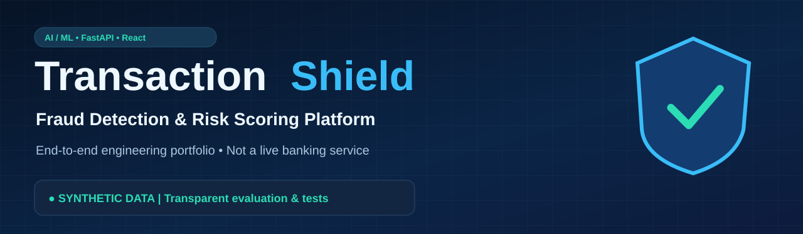
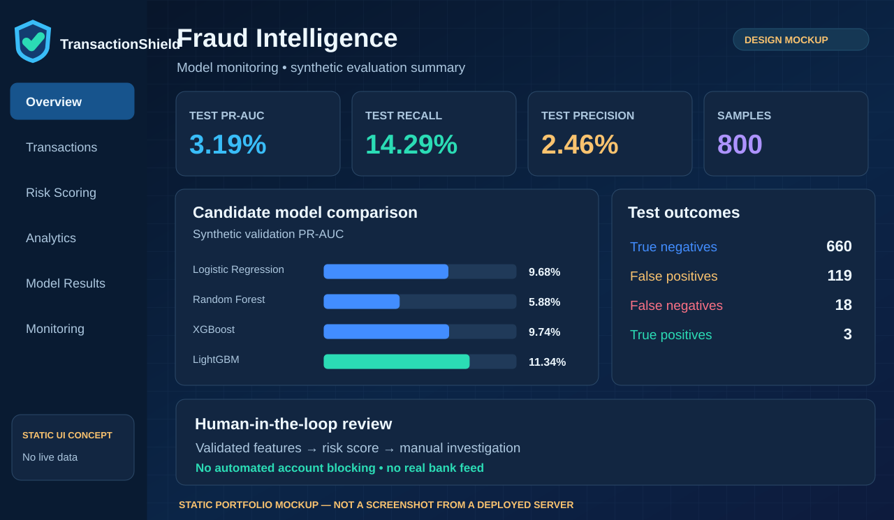
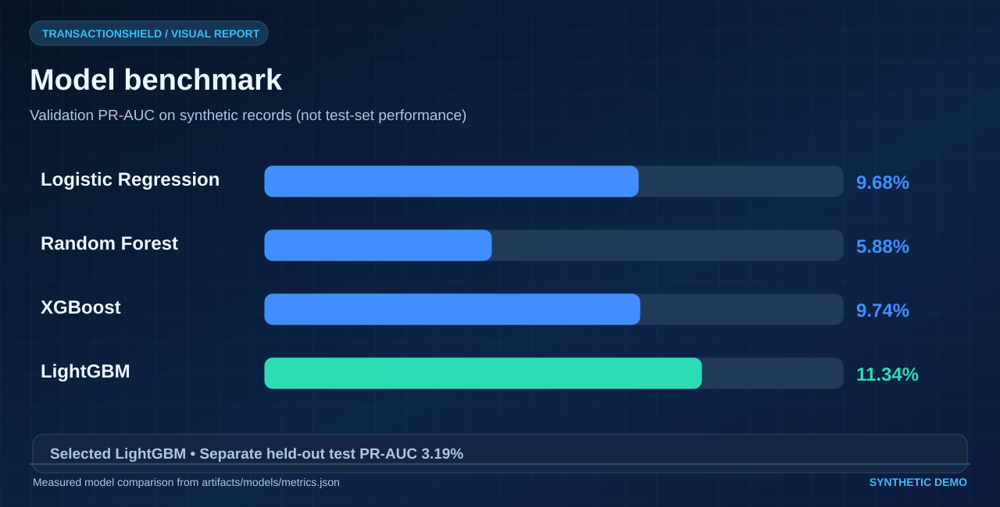
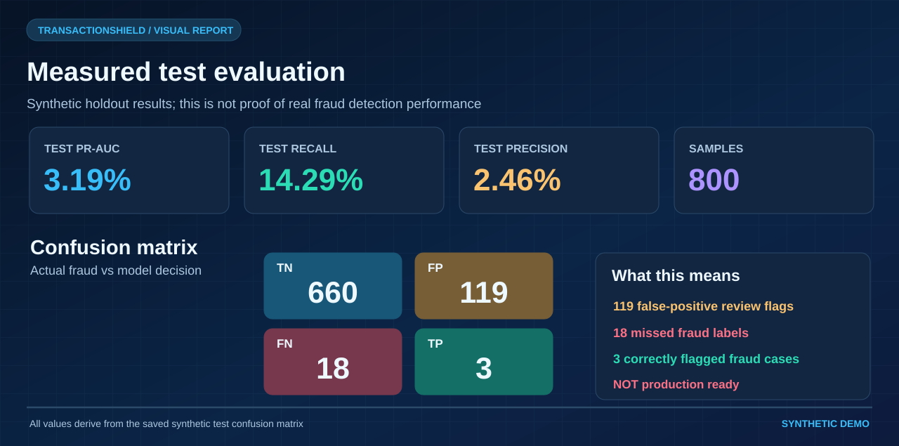
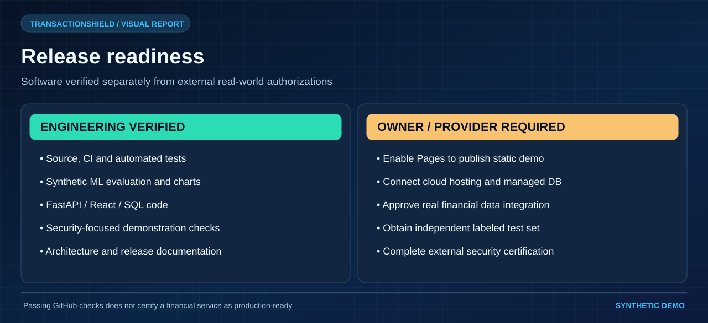

# 🛡️ TransactionShield — Real-Time Fraud Detection & Risk Scoring Platform

> **Portfolio/demo application** · Machine learning + FastAPI + React + SQLAlchemy/PostgreSQL + Docker + optional MLflow and SHAP. **Data, predictions, and evaluation are synthetic. This is not a production fraud detector.**

## Visual tour

> **Synthetic-only demonstration.** The dashboard graphic is a concept, not a capture of a live deployment. All plotted metrics come from the recorded synthetic experiment.



| Architecture | Model comparison (validation PR-AUC) |
| :---: | :---: |
|  |  |

| Measured held-out metrics | Release readiness |
| :---: | :---: |
|  |  |

[View the complete visual gallery](docs/VISUAL_GALLERY.md) · [Original detailed architecture](docs/screenshots/transactionshield-architecture.png)


## What it does
TransactionShield scores synthetic credit card, wallet, transfer, and e-commerce transaction attributes. A fitted classifier estimates a fraud score; configurable rule-based review hints complement (but do **not** explain) the model. The REST API persists scored transactions and a responsive React dashboard visualizes review flags, history, risk distribution, and measured synthetic test metrics. The dashboard refreshes every 30 seconds; this is polling rather than a stream processor.

### Features
- Deterministic synthetic transaction generation and validation, without real financial data.
- Leakage-safe scikit-learn preprocessing; **chronological** train/validation/test evaluation.
- Logistic Regression, Random Forest and optional XGBoost/LightGBM comparison by **validation PR-AUC**.
- Independent validation F2 threshold selection; held-out precision, recall, F1, PR-AUC, ROC-AUC, Brier score and confusion matrix.
- Optional tree SHAP summary function and MLflow tracking. UI review hints are separate explicit rules.
- FastAPI: `/predict`, `/history`, `/transactions/{id}`, `/statistics`, `/analytics`, `/metrics`, `/health`, and `/docs`.
- Pydantic constraints, duplicate transaction ID protection, SQLite development fallback, PostgreSQL Docker service.
- React / Recharts: Overview, Scoring, Transactions with CSV export, Analytics, Model Performance.
- Tests, architecture docs, workflows, reproducible charts, Docker Compose, local simulator.
- Alembic migration, readiness checks, request-security guardrails, drift monitoring API and React monitoring tab.
- Optional Kafka-compatible synthetic producer/consumer with at-least-once offset commits.
- Clear demo-review feedback provenance and operational deployment/security runbooks.

## Verified model artifacts and repeatable Docker builds

- The committed synthetic model and metrics have a SHA-256 manifest (`artifacts/models/model_manifest.json`) checked before predictions and in `/ready`.
- Docker **does not retrain at build time**. Explicit training updates the model, metrics, and manifest together. The API fails closed with HTTP 503 for corrupt model output.
- Run `python scripts/verify_model_artifact.py` to check consistency. SHA-256 is **not** a digital signature, a guarantee against malicious pickle contents, or evidence of real fraud-detection performance.
- [Model integrity and release guide](docs/MODEL_INTEGRITY.md)

## Quickstart (Python 3.11 recommended, Node.js 20+)
```bash
python -m venv .venv
# Windows: .venv\Scripts\activate
# Linux/macOS: source .venv/bin/activate
pip install -r requirements-dev.txt
python scripts/generate_demo.py
python -m ml.training.train
python scripts/verify_model_artifact.py
python scripts/create_report.py
pytest -q
uvicorn backend.app.main:app --reload
```
Open a second terminal:
```bash
cd frontend
npm install
npm run dev
```
React: http://localhost:5173 · API documentation: http://localhost:8000/docs

Or run `docker compose up --build -d` after training for PostgreSQL + React/Nginx + API (UI: http://localhost:3000). Optional MLflow tracking via `docker compose --profile tracking up -d mlflow` and `MLFLOW_TRACKING_URI=http://localhost:5000 python -m ml.training.train --tracking`.

## Example transaction
```json
{"amount":1500,"hour":2,"account_age_days":10,"velocity_24h":11,"prior_chargebacks":1,"ip_risk_score":0.85,"is_international":1,"is_new_device":1,"merchant_category":"gaming","transaction_type":"card"}
```
POST to `/predict` and inspect `fraud_probability`, `risk_score` (0–100), `risk_level`, `is_flagged` and `reasons`. The probability is *not guaranteed calibrated*; the decision threshold is tuned on validation samples; risk category bands are demonstration policy thresholds.

## Data safety and provenance
**NO customer data or credit card numbers** included. `data/raw/synthetic_transactions.csv` is generated locally and ignored by Git. Never present results as actual bank or card-network model performance. Deploy only after a thorough security, legal, calibration, human-review, fairness and ground-truth evaluation program.

## Documentation & bookmarks
- [Visual gallery](docs/VISUAL_GALLERY.md)
- [System architecture](docs/ARCHITECTURE.md)
- [Repository tree](docs/PROJECT_TREE.md)
- [Measured synthetic results & graphs](docs/RESULTS.md)
- [Development workflow](docs/PROJECT_WORKFLOW.md)
- [API endpoints](docs/API_REFERENCE.md)
- [Model card, limitations & dataset provenance](docs/MODEL_CARD.md)
- [Deployment instructions](docs/DEPLOYMENT.md)
- [Test plan](docs/TEST_PLAN.md)
- [Security policy & threat model](docs/SECURITY.md)
- [Operational runbook and optional Kafka](docs/OPERATIONS.md)
- [Production readiness gaps](docs/PRODUCTION_GAP_ANALYSIS.md)
- [Authorized, PII-minimized feed validation](docs/INTEGRATION_CONTRACT.md)
- [Frozen-model independent holdout evaluator](docs/INDEPENDENT_VALIDATION.md)
- [Public offline preview on GitHub Pages](docs/PUBLIC_DEMO.md)
- [Protected cloud staging Blueprint](docs/CLOUD_STAGING.md)
- [Dataset documentation](data/README.md)
- [Model comparison chart](artifacts/reports/model_comparison.png) · [Precision-recall chart](artifacts/reports/precision_recall.png) · [Confusion matrix](artifacts/reports/confusion_matrix.png) · [SHAP illustration](artifacts/reports/shap_summary.png)
- [GitHub Actions](.github/workflows/ci.yml)
- [FastAPI documentation](http://localhost:8000/docs) (after starting local backend)
- [MLflow documentation](https://mlflow.org/docs/latest/index.html)
- [SHAP documentation](https://shap.readthedocs.io/)

## Interview-ready explanation
"I created an end-to-end fraud risk scoring demo that generates synthetic transactions, evaluates multiple classifiers under a chronological split, tunes a threshold independently from test data, and serves predictions over FastAPI. I built a React dashboard, stored predictions in SQL, included optional SHAP/MLflow experiments and automated tests. I emphasize precision-recall tradeoffs and avoid treating synthetic validation as proof of production fraud performance."

## Project roadmap
- **Implemented:** Synthetic data, ML model comparisons, risk scoring, SQL persistence, REST API, responsive React dashboard, CI, Docker, documentation.
- **Implemented expansion:** Initial Alembic schema, health/readiness, synthetic drift monitoring and bounded review feedback, security defaults, monitoring UI, optional Kafka-compatible demo integration.
- **Implemented evaluation/deployment expansion:** strict authorized CSV contract, frozen-model external holdout report with bootstrap intervals, streaming request-byte ceiling, offline static React preview, Pages publishing workflow, and optional Render API+PostgreSQL staging blueprint. These require real owner configuration to publish/run.
- **Production blockers:** Consented labeled data and validation, calibration, tenant-aware identity, encryption and gateway policies, real backup/restore, hosted cloud infrastructure, managed event ingestion, independent audits, monitoring alerts and operational approvals. These cannot be claimed complete.
