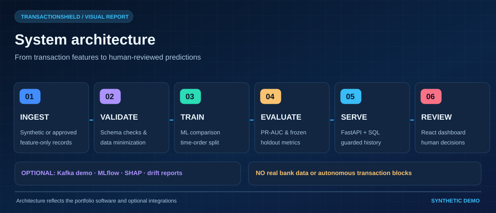
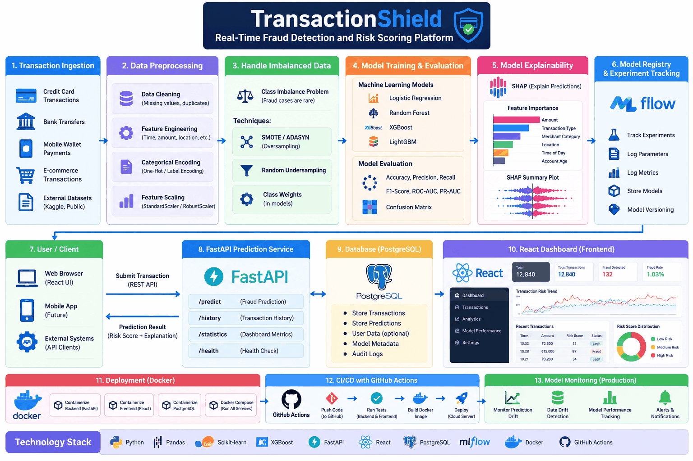
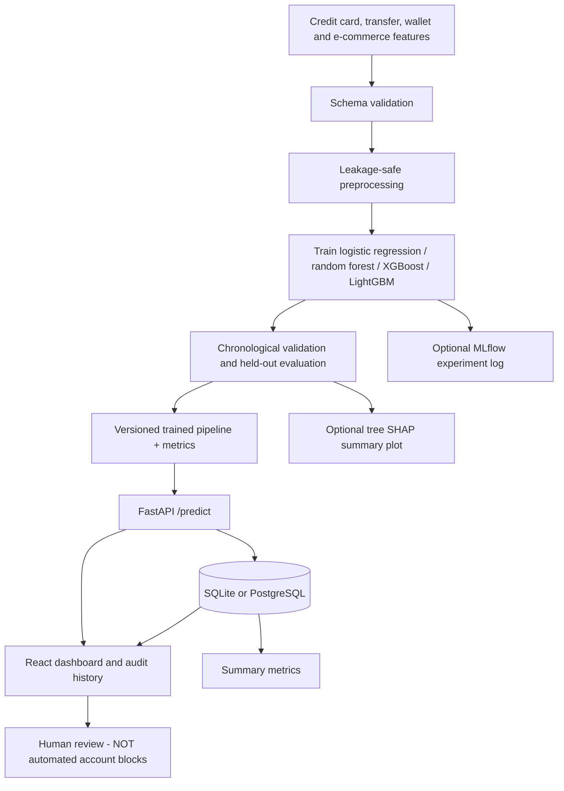

# Architecture

[Visual gallery](VISUAL_GALLERY.md)

- `ml/data`: synthetic data generator, schema validation, training-only preprocessing.
- `ml/training`: chronological 60/20/20 split. Four candidate estimators when available; selects model by validation PR-AUC, selects threshold on validation F2, measures once on holdout. Uses class weighting in baseline models; does not oversample the validation/test set. Tuning is separate from held-out evaluation.
- `ml/explainability`: optional SHAP summary for tree-based selected estimators. Frontend rule hints are intentionally **not** passed off as SHAP explanations.
- `ml/monitoring`: a simple standardized mean-shift illustration; no automated retraining or production drift alerts.
- `backend`: REST scoring, transaction-ID deduplication, SQLAlchemy persistence, summary analysis.
- `frontend`: Vite/React interactive pages; dashboard polls every 30 seconds instead of requiring Kafka/websockets.
- `docker-compose`: local PostgreSQL, FastAPI, React/Nginx, optional MLflow.

## Threat model and scope
The local HTTP demo has no end-user authentication by default; optional API key is a development convenience, not an enterprise identity layer. Production needs TLS, authentication and authorization, secrets management, rate limits, monitoring, migrations, retention and audit policies, systematic data validation, adversarial testing, controls on PII, calibrated thresholds and human fraud-analyst oversight. Never make financial access decisions from this synthetic model.
