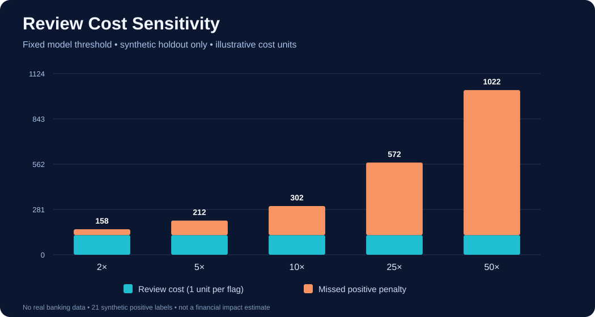

# Hypothetical review-cost analysis — synthetic demonstration only



## What the chart really means

The chart uses the **recorded held-out synthetic confusion matrix** from `artifacts/models/metrics.json` at the **existing fixed validation-selected threshold**. It does not tune the threshold with test labels or imply real fraud losses. For the checked-in illustrative test counts: true negatives = 660, false positives = 119, false negatives = 18, true positives = 3. There are 122 flagged reviews and 18 missed synthetic positives.

For a toy scenario where **every flagged review** costs 1 arbitrary unit and each **missed positive** adds `P` units, the total is `122 + 18×P`. With `P=2`, total=158; with `P=10`, total=302. These units are *not* rupees, dollars, settlement exposure, or statistically estimated business costs. No threshold is optimized here and one threshold cannot be judged in isolation from operational constraints. If model training changes, regenerate this chart from that exact committed run's metrics.

```bash
python scripts/decision_costs.py
pytest -q tests/test_decision_costs.py
```

## What would be needed for real decision support

To estimate real financial impact you would require authorized transactions with independently established outcome labels, cost definitions approved by fraud operations, review capacity, expected case mix, delayed feedback and appeals, representative prospective validation, calibrated scores, and human oversight. Until those exist the system is an educational demonstration, never an automatic block or adverse financial decision system.
