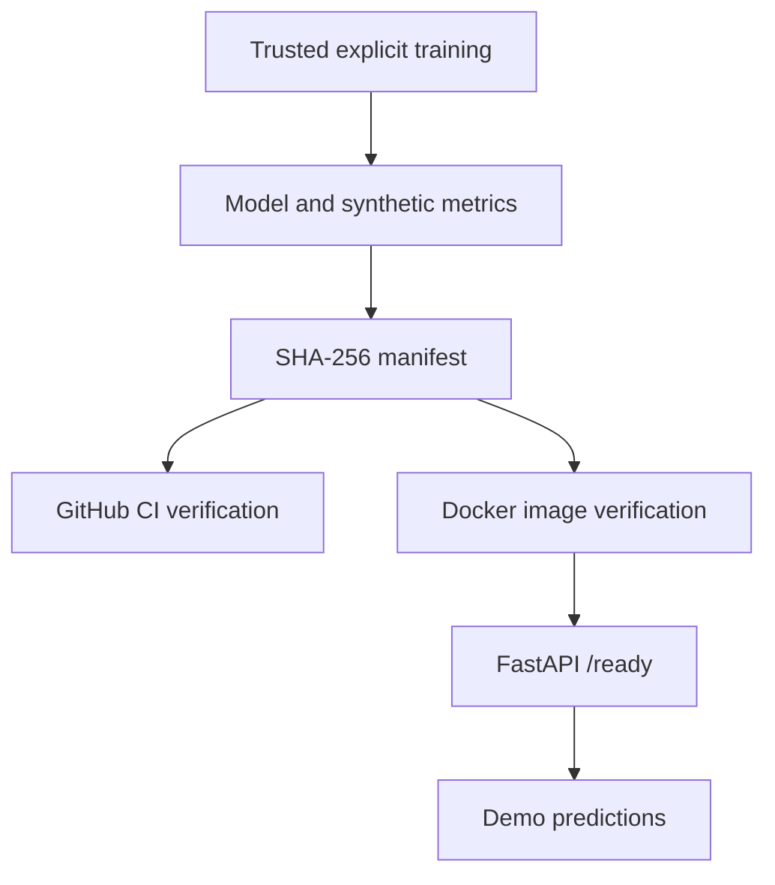

# Model integrity and repeatable deployment

**Purpose:** Educational synthetic risk scoring, not real payment decisions.

## Corrected deployment behavior

Previously the backend Docker build retrained a model with `--fast`, potentially replacing the model and metrics committed to GitHub. The Dockerfile now uses the recorded model and checks its manifest, without training.

The operator trains with `python -m ml.training.train`, which now regenerates `fraud_model.joblib`, `metrics.json`, and `model_manifest.json`. Run `python scripts/verify_model_artifact.py` before building or releasing. CI verifies the checked-in pair before tests, then verifies the freshly trained pair again. The Docker image checks its committed model at build time. API readiness returns HTTP 503 for corruption or disagreement, and score generation returns HTTP 503 for non-finite or out-of-range probabilities.

**Important:** These checks verify file integrity **relative to a trusted manifest**. They do not establish cryptographic authorship, secure serialization, fair or calibrated performance, or real-world approval. Joblib and pickle can execute arbitrary code when loaded; never load a model from an untrusted source.

Cloud account deployment, real authorized bank integration, independent labeled real-data evaluation, authenticated users, encryption and independent security certification are still external prerequisites.
