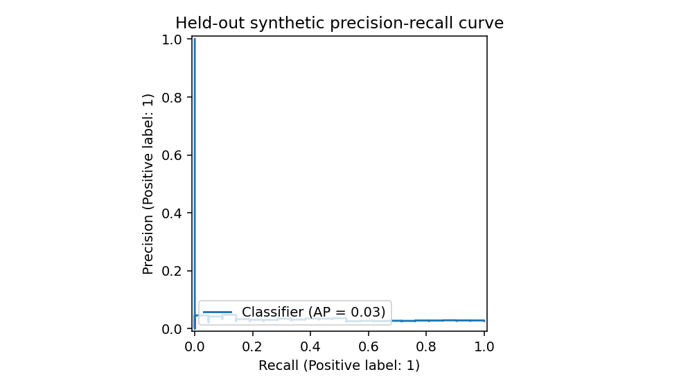
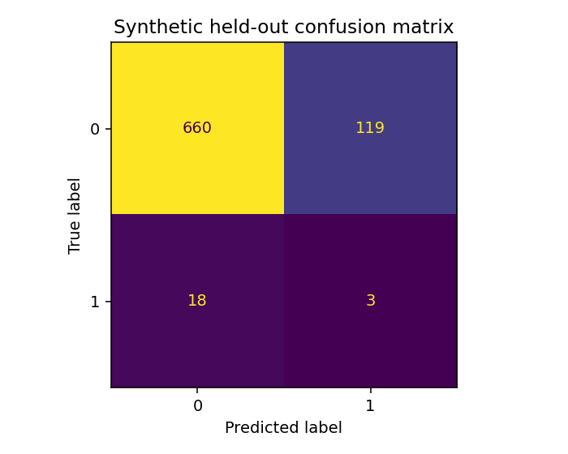
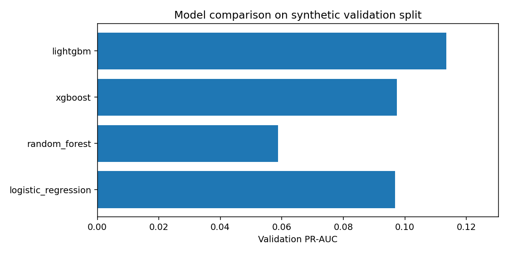
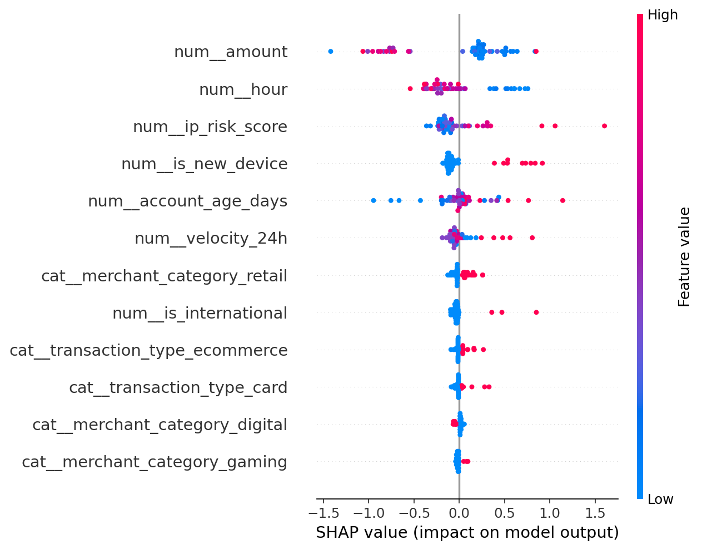

# Recorded synthetic evaluation results

[Visual gallery](VISUAL_GALLERY.md)

These figures were produced by `python -m ml.training.train --fast` on **4,000 fully synthetic transactions**, and are not estimates of real payment fraud detection ability.

| Measure | Value |
| --- | ---: |
| Fraud class prevalence | 2.33% |
| Selected model | lightgbm |
| Held-out records | 800 |
| Test fraud labels | 21 |
| Held-out PR-AUC | 0.0319 |
| Held-out recall | 0.1429 |
| Held-out precision | 0.0246 |
| Held-out F1 | 0.0420 |
| Held-out ROC-AUC | 0.5274 |
| Review threshold | 0.03 |

The selected threshold reflects recall-oriented validation F2, and generates many false alarms on these simulated records. This **does not justify deployment**. Synthetic validation rankings also differ from held-out outcomes. Improving calibration, representative data, drift monitoring, and operational cost tradeoffs is required before real-world deployment.

