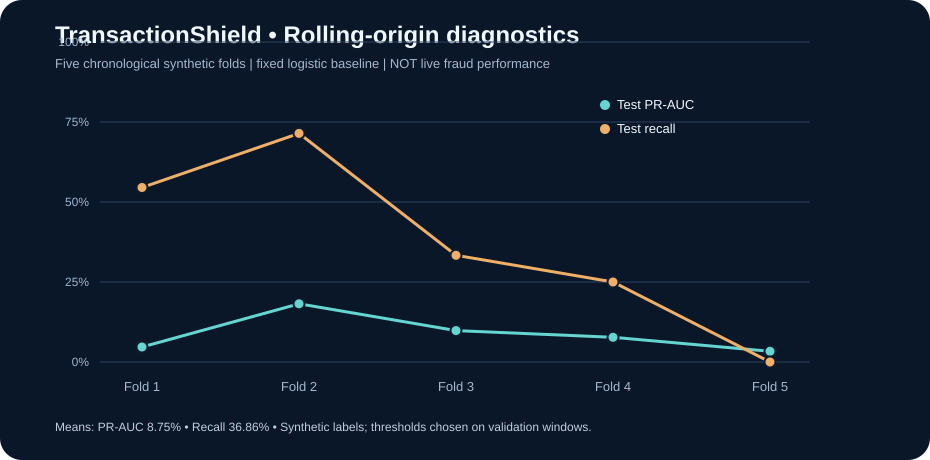

# Synthetic rolling-origin model diagnostics

This experiment trains a **fixed logistic-regression diagnostic baseline**, not the committed serving LightGBM pipeline. All 4,000 records and labels are entirely synthetic. No conclusions about live banking fraud detection are justified.

## Method

Each of five expanding windows separately fits the preprocessing and logistic model using historical rows only. A validation window selects an F2 review threshold. A later, non-overlapping test window reports precision, recall, F1, PR-AUC, and Brier score. No test labels can influence model fitting or per-fold threshold choice.

Run from the repository root after installing dependencies:

    python scripts/rolling_backtest.py

The command generates a detailed JSON report and PNG plot under artifacts/reports, without overwriting any serving model or its SHA-256 manifest. GitHub Actions reruns this experiment and stores its generated outputs as build artifacts.

## Recorded synthetic diagnostic averages

| Metric | Average across 5 folds |
|---|---:|
| Precision | 3.84% |
| Recall | 36.86% |
| F1 | 6.77% |
| PR-AUC | 8.75% |
| Brier score | 0.1987 |

These are descriptive statistics, **not confidence intervals**, and are not directly comparable to the selected serving model's single held-out evaluation. Individual fold scores vary substantially; one fold had zero test recall. Existing [held-out evaluation](RESULTS.md) and [model limitations](MODEL_CARD.md) remain unchanged.

## Limitations and data governance

- Tests are synthetic and do not represent any bank, payment network, or actual cardholder.
- Adjacent folds share earlier training history; fold observations are not independent.
- If a window contains only one class, the fold is skipped and reported, not silently fabricated.
- Real-world evaluation requires independently labeled consented data, settled outcomes, as-of-time features, calibration, fairness analysis, and an independent model review.
